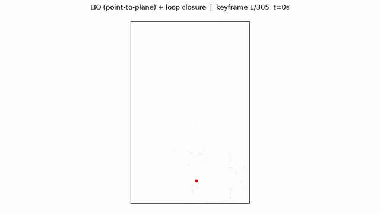
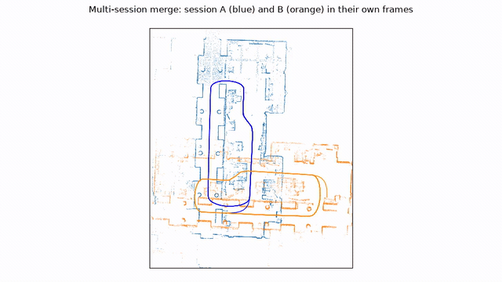

# plane-lio

## LIO mapping



## Map merge



LiDAR-inertial odometry + loop closure + multi-session map merge, as a small ROS-free C++ library
with offline tools. Refactor of [liangheming/iG-LIO_SAM_LC](https://github.com/liangheming/iG-LIO_SAM_LC)
(branch `refactor-p2plane`).

Full demo: [docs/demo/lio_to_merge.mp4](docs/demo/lio_to_merge.mp4)

## What changed vs upstream
| | upstream | plane-lio |
|---|---|---|
| LIO residual | GICP (point-to-plane only for the first 20 keyframes) | **point-to-plane**: kNN (k=5) PCA plane fit + planarity check + Cauchy IRLS weight, gated; GICP kept as an A/B option (`lio.residual`) |
| Structure | one ROS node mixing LIO, loop closure, localizer, FAST-LIO/ikd-tree duplicate builder | 3 modules: `core/` (LIO), `mapping/` (keyframes, loop closure, multi-session merge), `apps/` (offline executables) |
| Dependencies | ROS1 Noetic, livox_ros_driver2, Sophus, GTSAM, PCL | Eigen, Sophus, PCL, GTSAM, yaml-cpp, OpenMP |
| Config | `mapping.yaml` + `localize.yaml` + launch args | one file: `config/mid360.yaml` |
| Bug fixes | — | IMU mid-point integration used `head.acc+head.acc`; IESKF convergence used signed `maxCoeff` |
| Multi-session | — | `map_merge`: gravity-aligned (x,y,z,yaw) global search + ICP, inter-session loops, joint LM pose graph |

Removed: localizer, ikd-tree/FAST-LIO builder, ROS services/launch/rviz. A ROS wrapper is **not** included in
plane-lio (the box it was developed on had no ROS); the library has no ROS dependency, so a thin node only
needs to fill `lio::MeasureGroup` and call `LIOBuilder::process` / `LoopClosure::addPose`.

## Wheel / motion constraints (IESKF observations)
`core/src/motion_obs.cpp` adds, inside the same iterated update as the LiDAR residual (`kf::MeasurementSystem::add`):
wheel forward speed + non-holonomic constraint (`--wheel --nhc`, lever-arm and scale aware, Huber IRLS), ZUPT with
gyro-bias observation when the wheel reports standstill *and* the gyro is quiet (`--zupt`), soft bias bounds
(`--bias-limit`), and an optional proper bias random walk in prediction (`--bias-rw`, experimental, off by default).
All off by default (bit-identical to the previous behaviour). `tests/test_motion_obs.cpp` checks every analytic
Jacobian against numerical differentiation (`ctest`). Design inspired by lightning-lm's "several observation types
in one ESKF update" layout; see Credits.

## Layout
```
core/      lio_core: ieskf, imu_processor, voxel_map, lio_builder (residuals)
mapping/   lio_mapping_lib: keyframe (session I/O), loop_closure (radius search + ICP + iSAM2), map_merge
apps/      lio_mapping (LIO + loops on a dataset), map_merge (two sessions -> one map)
tools/     bag_to_frames.py (bag -> offline format), run_eval.sh (evo A/B), render_demo.py (offscreen mp4)
config/    mid360.yaml
```

## Build
```bash
sudo apt install libpcl-dev libgtsam-dev libyaml-cpp-dev libeigen3-dev
# Sophus 1.22+ is header-only and not packaged on Ubuntu. From a Sophus checkout:
#   cmake -S . -B /tmp/sophus-build -DSOPHUS_USE_BASIC_LOGGING=ON && sudo cmake --install /tmp/sophus-build
cmake -S . -B build -DCMAKE_BUILD_TYPE=Release && cmake --build build -j
```

## Run
```bash
pip install rosbags evo numpy scipy matplotlib
python tools/bag_to_frames.py loop.bag data/loop --lidar /eve/lidar3d --imu /eve/livox/imu
build/lio_mapping config/mid360.yaml data/loop runs/p2plane --residual point_to_plane   # or gicp
# two sessions + merge
build/lio_mapping config/mid360.yaml data/loop runs/a --start 0 --end 300
build/lio_mapping config/mid360.yaml data/loop runs/b --start 320 --end 623
build/map_merge runs/a runs/b runs/merged
tools/run_eval.sh data/loop loop_gt.tum runs
```

## Results (IILABS 3D, Livox Mid-360, sequence `loop`, 623 s, MoCap ground truth)
evo, SE(3) Umeyama alignment, `--t_max_diff 0.02`. GT is the MoCap body frame, LIO is the IMU frame
(small lever arm, not compensated).

| residual | APE RMSE odom | APE RMSE loop-closed | RPE@1m trans | RPE@1m rot | LIO time/scan |
|---|---|---|---|---|---|
| point-to-plane | 0.0214 m | 0.0219 m | 0.0867 m | 0.439° | 7.1 ms (OpenMP) |
| GICP (upstream) | 0.0206 m | 0.0211 m | 0.0953 m | 0.496° | 3.6 ms |

Multi-session (0–300 s and 320–623 s as two sessions): initial alignment ICP fitness 0.016,
50 inter-session loops, merged keyframes APE RMSE 0.0254 m in a single frame.

`render_demo.py` writes the clip checked in at `docs/demo/lio_to_merge.mp4`.

## Credits & license
MIT, see `LICENSE` (Copyright (c) 2024 liangheming). Based on iG-LIO_SAM_LC by liangheming, which builds on
[iG-LIO](https://github.com/zijiechenrobotics/ig_lio) (Zijie Chen et al.) and
[FAST-LIO](https://github.com/hku-mars/FAST_LIO) (HKU MARS). Dataset: IILABS 3D (INESC TEC).

Wheel/motion observation design is inspired by [lightning-lm](https://github.com/gaoxiang12/lightning-lm) (Gao Xiang).
That repository declares no license (package.xml: `TODO`) and its wheel / bias observation functions are not public,
so no code was copied; the models in `motion_obs.cpp` are derived independently.
